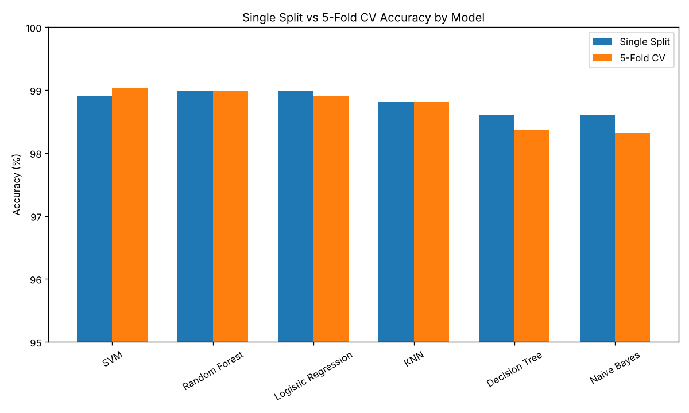
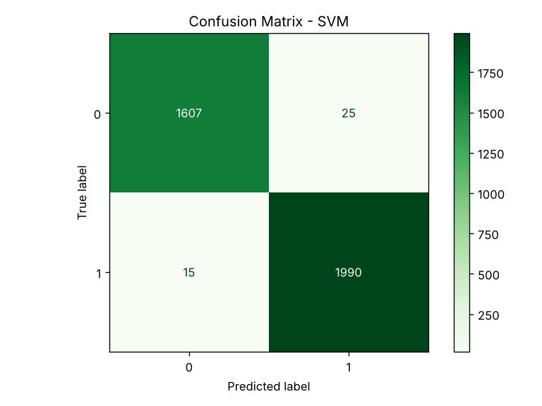
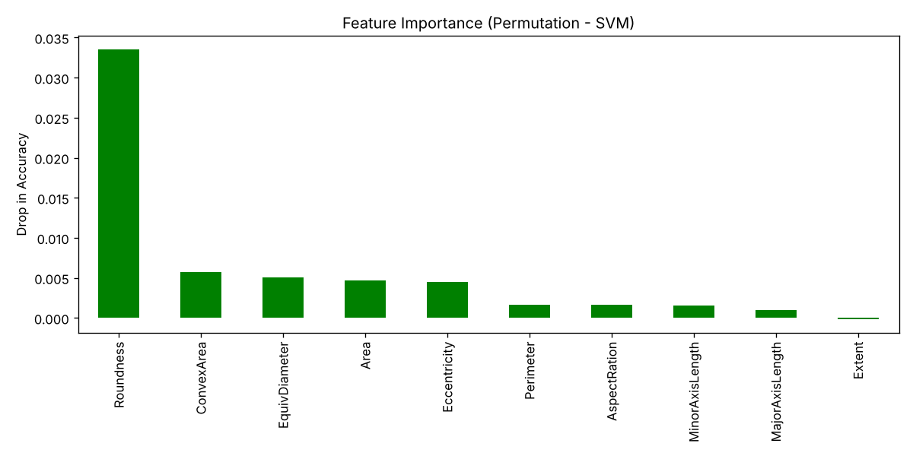

# Rice Type Classification

A machine learning project that predicts the rice type (Class 0 or Class 1) from 10 grain-shape measurements. Six classifiers are compared using a single 80/20 split and 5-fold cross-validation.

Seminar project by Karthick K, Government College of Technology, Coimbatore.

## Dataset

- 18,185 rice grains, each described by 10 shape and size features extracted from grain images
- Class 0: 8,200 grains · Class 1: 9,985 grains
- Features: Area, MajorAxisLength, MinorAxisLength, Eccentricity, ConvexArea, EquivDiameter, Extent, Perimeter, Roundness, AspectRation
- Source: [Rice Type Classification on Kaggle](https://www.kaggle.com/datasets/mssmartypants/rice-type-classification) (credit to the dataset author)

## Method

1. Explored the data with histograms, boxplots, violin plots, a correlation heatmap and a PCA projection
2. Split the data 80/20 (14,548 train, 3,637 test)
3. Scaled features with `StandardScaler`, fit on the training set only, so no test data leaks into training
4. Trained six models and evaluated each with a single split and 5-fold cross-validation
5. Checked the best model with a confusion matrix and permutation feature importance

## Results

| Model | Single split | 5-fold CV |
|---|---|---|
| SVM | 98.90% | **99.04%** |
| Random Forest | 98.98% | 98.98% |
| Logistic Regression | 98.98% | 98.91% |
| KNN | 98.82% | 98.82% |
| Decision Tree | 98.60% | 98.36% |
| Naive Bayes | 98.60% | 98.32% |

SVM was best on cross-validation. On the test set it classified 3,597 of 3,637 grains correctly.





## Key findings

- Roundness was by far the most important feature. Extent added almost nothing.
- Area, ConvexArea and EquivDiameter are almost perfectly correlated, so some features are redundant.
- The two classes form mostly separate clouds even in a 2-D PCA projection.

## Limitations

- All models score above 98%, so the classes are easy to separate with these features. The result does not show how well the models would work on a different rice dataset or on raw grain images.
- The features were already extracted from images. This project does not process images directly.

## Run it

```bash
pip install -r requirements.txt
python rice_classification.py
```

Charts are saved in the `images/` folder and the accuracy table in `results.csv`.

## Files

- `rice_classification.py`: full pipeline
- `data/riceClassification.csv`: dataset
- `images/`: charts used in this README
- `Rice_Type_Classification_Seminar.pdf`: seminar slides
